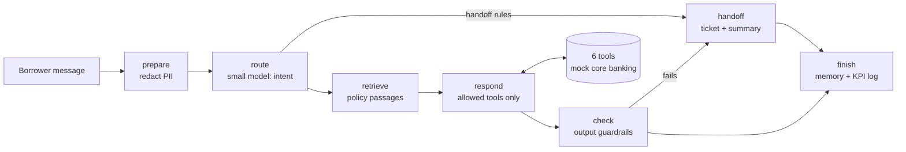

# LoanDesk

A customer support agent for **Udaan Microfinance**, a fictional Indian microfinance lender. It answers borrowers on chat about EMI due dates, failed payments, foreclosure amounts, contact changes and complaints, and hands off to a human when it should.

**Everything here is synthetic**: 1,000 generated borrowers, policy pages written for a fictional lender, and simulated traffic. Read every number as a pilot design, not a production result.

The core rule: **the model sorts the intent and words the reply. Amounts, dates and eligibility come from code**, so the model has nothing to invent them from.

## Quick start

```bash
cp .env.example .env            # add OPENROUTER_API_KEY
docker compose up -d postgres qdrant chroma
uv sync
uv run loandesk db seed         # 1,000 borrowers; prints the 10 scenario phone numbers
uv run loandesk ingest --store all
uv run loandesk chat --phone +919000000001
```

Or run everything in containers: `docker compose up --build`, then open http://localhost:8000/docs (API) and http://localhost:8000/admin (dashboard).

| Command | What it does | Costs money |
| --- | --- | --- |
| `loandesk chat` | Chat as a borrower in the terminal | yes |
| `loandesk serve` | HTTP API: `/chat`, `/webhooks/payment`, `/admin` | per chat |
| `loandesk eval run --cases seed` | 20 cases, report in `evals/reports/` | ~$0.55 |
| `loandesk eval run --cases all --gate` | 60 cases, fails below the bar in `evals/gate.yaml` | ~$1.65 |
| `loandesk experiment models --cases seed` | All 4 candidate models on the same cases | ~$1.40 |
| `loandesk experiment stores` | pgvector vs Qdrant vs Chroma vs Pinecone | free |
| `loandesk experiment simulate --n 500` | 500 conversations for the dashboard | ~$2.20 |
| `loandesk eval calibrate <report.json>` | Judge vs your hand labels | free |
| `loandesk models check` | Every configured model exists and supports tools | free |
| `loandesk spend` | Spend so far against the $10 cap | free |

Every paid command prints a cost estimate and asks before it runs. The ledger in `.loandesk/spend.json` refuses any model call once spend reaches `LOANDESK_BUDGET_USD` (default $10). Set a limit on the OpenRouter key too.

## How a request moves



Details in [docs/architecture.md](docs/architecture.md).

## The five layers

| Layer | Where it lives |
| --- | --- |
| 1. Scope and architecture | [docs/](docs/): discovery, intent map, rule vs LLM, blueprint, PRD |
| 2. Wrapping: knowledge, tools, memory, integrations | `knowledge/`, `vectorstores/`, `tools/`, `db/`, `integrations/`, `agent/` |
| 3. Evals and guardrails | `evals/`, `guardrails/`, `.github/workflows/ci.yml` |
| 4. Production and ops | `Dockerfile`, `docker-compose.yml`, `api/`, `tracing.py`, `llm/budget.py` |
| 5. Optimization | `config/models.yaml` (routing, caching), `experiments/` |

## Experiments

**Models.** Every call goes through [OpenRouter](https://openrouter.ai), so a model is one line in `config/models.yaml`. Four candidates are compared on the same cases, with a fixed judge from a fifth model family:

| Slot | Model |
| --- | --- |
| Claude | `anthropic/claude-sonnet-5.5` |
| GPT | `openai/gpt-5.6-terra` |
| Open-weight | `qwen/qwen3.8-27b` |
| Cheap and fast | `google/gemini-3.5-flash-lite` |
| Judge (fixed) | `deepseek/deepseek-v4-pro` |

**Vector databases.** pgvector, Qdrant, Chroma and Pinecone sit behind one four-method interface (`vectorstores/base.py`). Embeddings are local (fastembed, `BAAI/bge-small-en-v1.5`) and fixed, so the benchmark measures the databases. See [docs/experiments.md](docs/experiments.md) for the method and what the results do and don't show.

## Rollback

Prompts are versioned in `prompts/v1/`, and every model is an exact slug in `config/models.yaml`. Rolling back is one change to `LOANDESK_PROMPT_VERSION` or `LOANDESK_MODELS_CONFIG`, then a restart. Each logged turn records the prompt version and models that produced it.

## Limits

- All data is synthetic: 1,000 generated borrowers, and simulated conversations.
- WhatsApp is replaced by an HTTP chat endpoint; the phone number stands in for the WhatsApp sender id.
- Zendesk uses a local mock unless credentials are set (a 14-day trial account works).
- OTPs are not sent anywhere. In `fixed` mode the code is always 123456.
- The policy pages are written for this project, based on the RBI microfinance directions (2022). They are not a real lender's terms.
- Tracing writes JSON lines to `.loandesk/traces/`; there is no Langfuse or LangSmith integration yet.
- Conversation memory is in-process by default; set `LOANDESK_CHECKPOINTER=postgres` to persist it.
