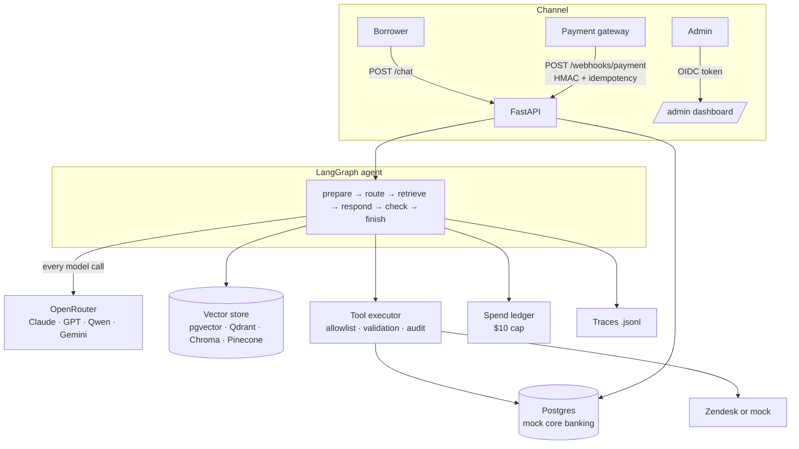

# Architecture

## Components

## One request, step by step

| Node | What happens | Model? |
| --- | --- | --- |
| prepare | Phone numbers and emails become `[PHONE_1]`-style placeholders (real values stay in a per-conversation vault). Aadhaar, PAN and account numbers are dropped. The redacted message joins the conversation memory. | no |
| route | The router model returns intent, confidence, `wants_human`, `abusive`, language. Rules then decide a handoff: abusive or distressed, asked for a human, unknown intent, confidence below 0.75, or an unregistered number asking about an account. | small |
| retrieve | Top 4 policy passages for the redacted message. | no (local embeddings) |
| respond | The responder sees only the tools allowed for the intent. Tools never take a borrower id: the harness injects it from the channel. Up to 6 tool rounds. | yes |
| check | No fee-waiver promises; every ₹ amount must appear in a tool result or a policy passage; no identity numbers in the reply. | no |
| handoff | A ticket with a summary (reason, intent, tools already called, the redacted message), and a fixed reply in the borrower's language. | no |
| finish | Reply into memory; a row in `conversation_turns` for the dashboard. | no |

## Guardrails and where they run

| Guardrail | Where | Risk |
| --- | --- | --- |
| Handoff below 0.75 confidence, and on abuse, distress or a request for a human | route | Wrong intent, wrong answer |
| OTP before `update_contact` | tool | Account takeover |
| PII redaction with a vault | prepare, audit log | DPDP; OWASP LLM02 |
| Borrower id injected, never a tool argument | tool executor | Reading another borrower's account |
| Tool allowlist per intent | tool executor | OWASP LLM06 excessive agency |
| Messages and policy text wrapped in tags and treated as data | prompt, tests | OWASP LLM01 prompt injection |
| No waiver promises; amounts grounded in tool output | check | Policy breach, invented numbers |
| Every tool call written to `audit_log` (arguments redacted) | Postgres | Traceability for complaints |
| Budget ledger; fallback to a human on provider errors | LLM client, respond | Runaway cost, outages |

## Memory

- **Short term:** LangGraph checkpointer state per conversation, keyed by a hash of the phone number. It holds redacted messages and the placeholder vault. `memory` (default) or `postgres`.
- **Long term:** the borrower's last 5 tickets, read from the local mirror of Zendesk tickets and put into the responder's context.
